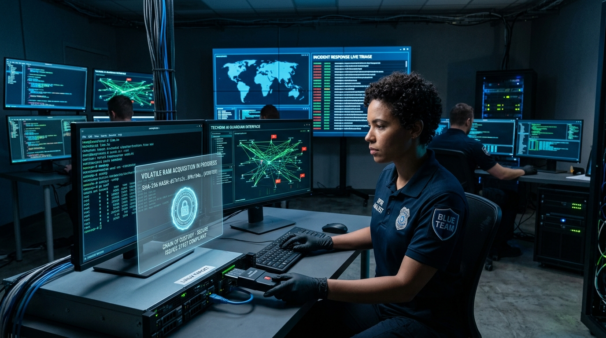
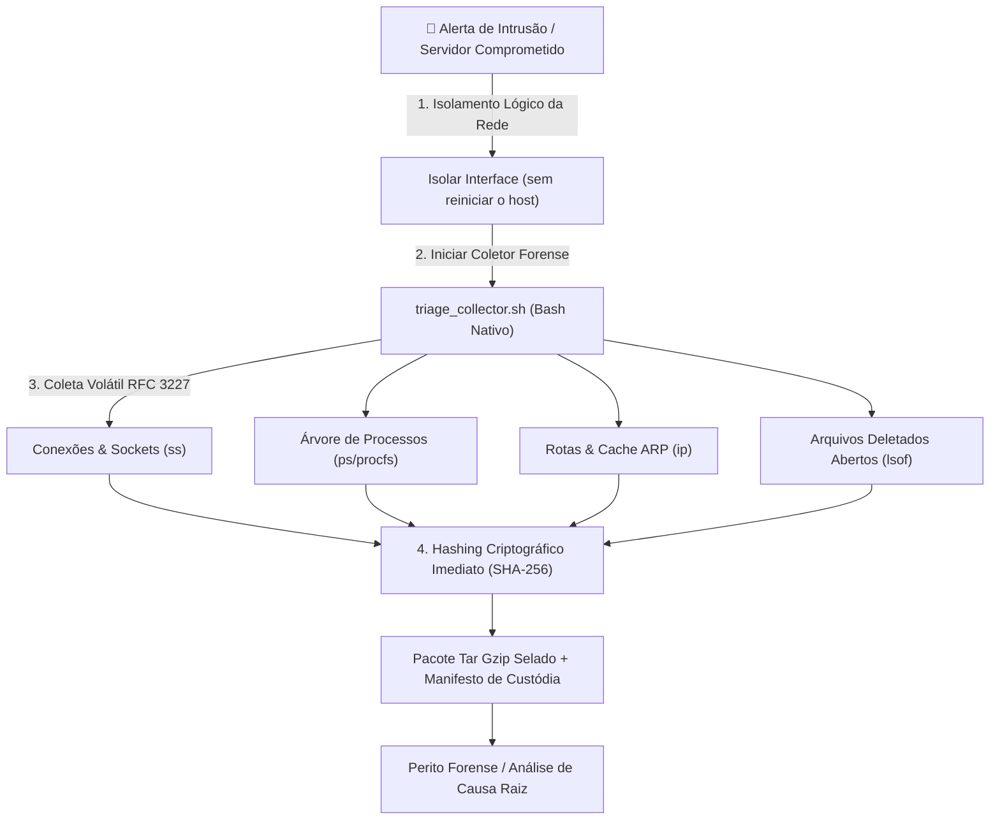

# 🔍 Linux Incident Response Triage Collector
## Coletor Forense Live-Response Volátil em Conformidade com a Norma ISO/IEC 27037 e RFC 3227



[](https://techdimbr.github.io/techdimbr/)
[](https://www.techdim.com.br)
[](https://www.iso.org/standard/44381.html)
[](https://datatracker.ietf.org/doc/html/rfc3227)
[](README.md)
[](README.md)
[](LICENSE)

> **Ferramenta de resposta a incidentes para coleta rápida e forense de evidências voláteis em servidores Linux comprometidos. Respeito absoluto à ordem de volatilidade da RFC 3227, zero modificação do sistema alvo e geração imediata de manifesto criptográfico SHA-256 para validade jurídica.**

---

## 🏛️ Visão Geral & Proposta de Valor

Durante um incidente de segurança (ransomware, invasão de shell reversa ou mineração não autorizada), a primeira reação errônea comum é reiniciar o servidor ou instalar ferramentas pesadas de diagnóstico que sobrescrevem a memória RAM e destroem metadados vitais de inodes.

O **Linux Incident Response Triage Collector** executa o protocolo forense correto:
1. **Preservação da Ordem de Volatilidade (RFC 3227):** Coleta conexões ativas (`ss -tulpn`), tabela ARP/vizinhos (`ip neigh`), processos detalhados com árvore PID (`ps auxf`), descritores de arquivos abertos (`lsof`) e módulos de kernel carregados antes que o invasor limpe os vestígios.
2. **Zero Poluição de Evidências:** Escrito em Bash nativo estrito (POSIX), utilizando os próprios binários estáticos ou ferramentas nativas do sistema sem compilar nem instalar pacotes que alterem o estado do disco.
3. **Cadeia de Custódia Inviolável (ISO/IEC 27037):** Cada arquivo de saída recebe timestamp militar UTC e tem seu hash SHA-256 calculado imediatamente, selado em um manifesto final assinado.

---

## 🏗️ Protocolo de Resposta Forense



---

## ⚡ Início Rápido

### Execução da Coleta Forense
```bash
# 1. Clonar ou transferir o repositório para o host alvo
git clone https://github.com/Techdimbr/linux-ir-triage-collector.git
cd linux-ir-triage-collector

# 2. Inicializar o ambiente local
./iniciar.sh

# 3. Executar o coletor de triagem (requer permissão de root para ler sockets e /proc)
sudo 03_APLICACAO/src/triage_collector.sh --output-dir /tmp/triage_output
```

---

## 🛡️ Governança & Contato Corporativo
- **Autor:** Deivis Írio Mayer (Kether_1)
- **Entidade:** TECHDIM INOVA SIMPLES (I.S.) - ME · CNPJ 61.933.926/0001-24
- **Website Oficial:** [https://www.techdim.com.br](https://www.techdim.com.br)
- **Portal de Soluções:** [https://techdimbr.github.io/techdimbr/](https://techdimbr.github.io/techdimbr/)
